# 발표 대본 (2026-11-24 발표 자료, 20장)

## 1. 표지

**핵심 내용**

A Survey on Efficient Knowledge Distillation for Vision

**대본**

비전 분야의 효율적 지식 증류에 관한 서베이를 발표하겠습니다. 증류는 학습 중 교사도 매번 실행해야 해서 비용이 큽니다. 이 비용을 줄이는 기법을 정리하고, 실제로 얼마나 줄고 무엇을 잃는지 실험으로 확인했습니다.

**용어**

- 지식 증류(KD): 큰 교사 모델의 출력(확률 분포·특징)을 작은 학생 모델이 따라 하도록 학습시키는 방법.
- 교사 / 학생: 이미 학습된 큰 모델 / 실제로 배포할 작은 모델.

---

## 2. Question

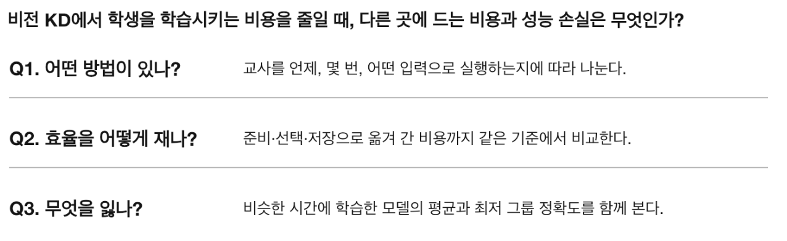

**핵심 내용**

비전 KD에서 학생 학습 비용을 줄일 때, 다른 곳에 드는 비용과 성능 손실은?
- Q1 어떤 방법이 있나: 교사를 언제·몇 번·어떤 입력으로 실행하는지로 구분
- Q2 효율을 어떻게 재나: 준비·선택·저장으로 옮겨 간 비용까지 같은 기준에서 비교
- Q3 무엇을 잃나: 비슷한 시간에 학습한 모델의 평균과 최저 그룹 정확도

**대본**

큰 질문은 "학생 학습 비용을 줄일 때, 다른 곳에 드는 비용과 성능 손실은 무엇인가"입니다. 이를 어떤 방법이 있는지, 효율을 어떻게 재는지, 무엇을 잃는지의 세 질문으로 나눴습니다.

**용어**

- 최저 그룹 정확도(worst-group accuracy): 데이터를 그룹(예: 배경×새 종류)으로 나눴을 때 가장 낮은 그룹의 정확도. 평균에 가려진 소수 그룹의 실패를 드러낸다.

---

## 3. Searching

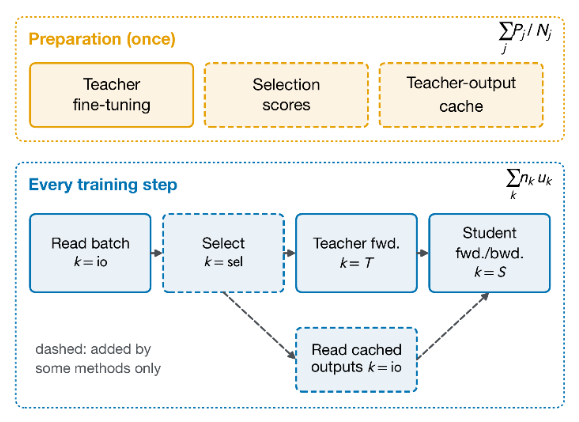

**핵심 내용**

- A. 비용 분해: 준비 비용 + 반복 비용 → Shrink · Skip · Reuse · Substitute
- B. 문헌 비용 검증: 최종 문헌 40편 조사, 부족한 비교를 실험으로 검증

**대본**

비용을 학습 전 한 번 드는 준비 비용과 매 스텝 드는 반복 비용으로 나눴습니다. 줄이는 비용 항에 따라 Shrink, Skip, Reuse, Substitute 네 축으로 분류하고, 40편을 조사한 뒤 부족한 비교는 실험으로 검증했습니다.

**용어**

- 준비 비용: 학습 전에 한 번 드는 비용(교사 미세 조정, 선택 점수 계산, 교사 출력 캐시 생성).
- 반복 비용: 매 학습 스텝마다 드는 비용(배치 읽기, 교사 순전파, 학생 순전파·역전파).
- Shrink / Skip / Reuse / Substitute: 교사 1회 비용 축소 / 교사 호출 횟수 축소 / 교사 출력 저장 후 재사용 / 교사·데이터를 싼 것으로 대체.

---

## 4. Result – 보고값 사례

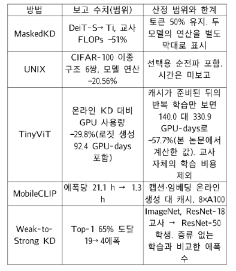

**핵심 내용**

- 원 논문 보고값 −29.8%: 온라인 KD 대비 GPU 사용량, 로짓 생성 92.4 GPU-days 포함
- 본 서베이 계산값 −57.7%: 학생 반복 학습만 비교 (140.0 대 330.9 GPU-days)
- ⇒ 측정 범위를 정의해야 한다

**대본**

TinyViT는 로짓 생성 비용을 포함해 GPU 사용량 29.8% 절감을 보고했습니다. 캐시 이후 학생 학습만 비교하면 57.7%입니다. 같은 방법도 세는 범위에 따라 절감률이 두 배 가까이 달라지므로, 측정 범위부터 정의해야 합니다.

**용어**

- GPU-days: GPU 한 장을 하루 쓴 양. 학습 비용의 단위.
- 온라인 KD: 매 스텝 교사를 실제로 실행해 출력을 받는 일반적인 증류.
- 로짓(logit): 소프트맥스 전 모델의 클래스별 점수.

---

## 5. Researching – 네 축

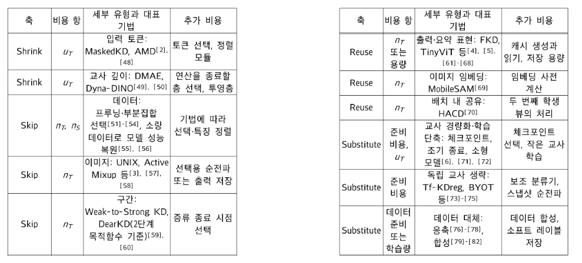

**핵심 내용**

- 네 가지 기법에서 바뀌는 비용과 학습 신호

**대본**

Shrink는 교사 입력이나 깊이를 줄이고, Skip은 교사 호출 횟수를 줄입니다. Reuse는 교사 출력을 저장해 다시 쓰고, Substitute는 교사나 데이터를 더 싼 것으로 바꿉니다. 축마다 선택 연산, 캐시, 준비 비용 같은 추가 비용이 생깁니다.

**용어**

- 토큰: ViT가 이미지를 잘라 만든 패치 단위 입력. 토큰을 줄이면 교사 연산이 준다.
- 캐시: 교사 출력을 미리 계산해 디스크에 저장해 둔 것.
- 데이터셋 응축·합성: 원본 대신 적은 수의 요약 이미지나 생성 이미지로 학습하는 방법.

---

## 6. Researching – 문헌 집계

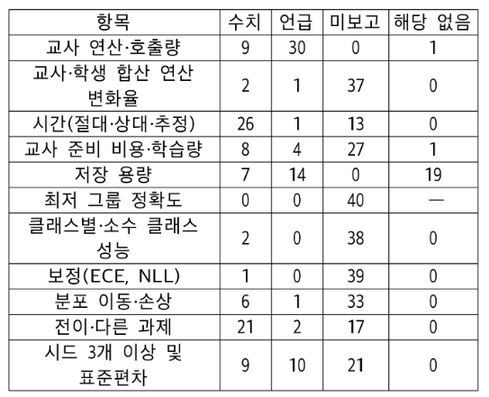

**핵심 내용**

- 문헌 조사 원표: 교사 연산 9편, 합산 연산 변화율 2편, 시간 26편, 교사 준비 8편 수치 보고
- 최저 그룹 0편, 클래스별 2편, 보정 1편

**대본**

40편 중 교사 연산량은 9편, 시간은 26편이 수치로 보고했습니다. 교사·학생 합산 연산 변화율은 2편, 교사 준비 비용은 8편뿐입니다. 최저 그룹 정확도는 한 편도 보고하지 않아, 직접 실험이 필요했습니다.

**용어**

- 수치 보고 / 언급 / 미보고: 비용·지표를 숫자로 제시 / 글로만 언급 / 아예 다루지 않음.
- 합산 연산 변화율: 교사와 학생 연산을 합친 전체 학습 연산이 얼마나 줄었는지.

---

## 7. Experiment – 질문과 데이터

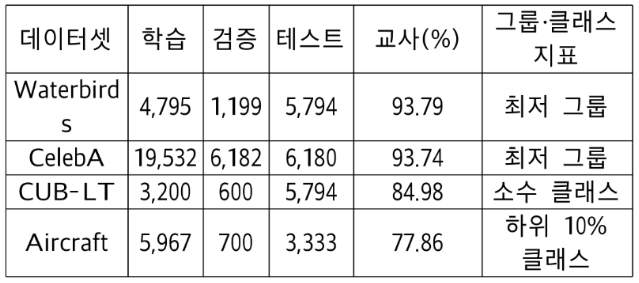

**핵심 내용**

- Q1 얼마나 비용을 감축하는가? → 같은 범위의 100에폭 Full KD와 비교
- Q2 교사 연산을 줄인 만큼 실측 시간도 줄어드는가? → 60~70에폭 단축 Full KD와 비교
- Q3 비슷한 시간에서 평균/최저 그룹 순위는 동일한가? → 토큰 예산, 뷰, 데이터 선택/규모 대조

**대본**

얼마나 줄이는지, 연산을 줄인 만큼 시간도 주는지, 비슷한 시간에서 평균과 최저 그룹 순위가 같은지를 봤습니다. Waterbirds·CelebA는 최저 그룹, CUB-LT는 소수 클래스, Aircraft는 하위 10% 클래스를 평가했습니다.

**용어**

- Full KD: 모든 스텝·모든 이미지에 교사를 쓰는 표준 증류(100에폭).
- 단축 Full KD: 에폭 수만 줄인(60·70에폭) Full KD. 비슷한 시간 기준선.
- 소수 클래스 정확도: 학습 이미지가 적은 클래스들의 정확도(CUB-LT).
- 에폭: 학습 데이터 전체를 한 번 도는 단위.

---

## 8. Experiment – 연산 대비 시간

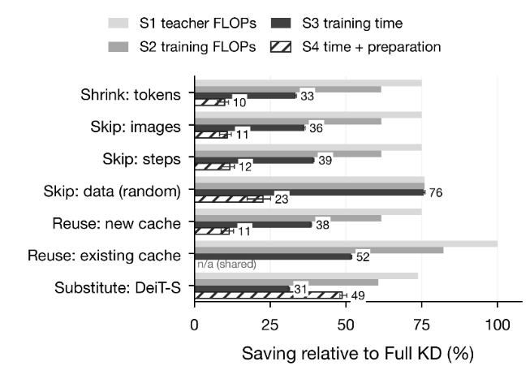

**핵심 내용**

- 예산 25%에서의 세 데이터셋 평균: 교사 연산량과 실제 시간의 감축률

**대본**

예산 25%에서 교사 연산은 약 75% 줄었지만 학습 시간은 33–39%만 줄었습니다. 준비 시간까지 넣으면 10% 안팎으로 떨어지고, Substitute만 49%로 가장 컸습니다. 재는 범위에 따라 순위가 바뀝니다.

**용어**

- S1–S4 산정 범위: S1 교사 연산, S2 학습 전체 연산, S3 학습 시간, S4 준비 시간까지 포함한 시간.
- FLOPs: 부동소수점 연산 수. 연산량의 단위.

---

## 9. Experiment – 대표 조건 비교

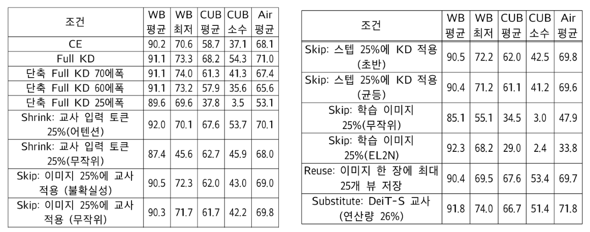

**핵심 내용**

- 네 축의 대표 조건 비교

**대본**

CUB-LT와 Aircraft에서는 Shrink, Reuse, Substitute가 비슷한 시간의 단축 Full KD보다 평균 정확도가 높았습니다. 학습 이미지 자체를 줄인 데이터 Skip은 크게 떨어졌습니다.

**용어**

- CE: 교사 없이 정답 레이블만으로 학습한 학생(교차 엔트로피 손실).
- 예산 25%: 기법마다 뜻이 다름(토큰 25% 유지, 이미지 25%에 교사 적용, 이미지당 뷰 25개 저장 등).

---

## 10. Experiment – Waterbirds 순위 역전

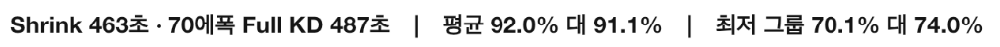
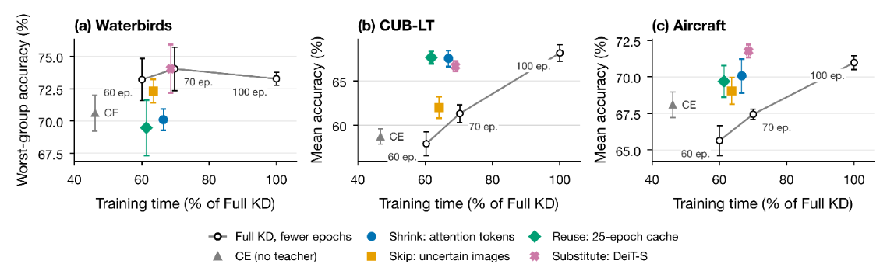

**핵심 내용**

- Shrink 463초 · 70에폭 Full KD 487초 | 평균 92.0% 대 91.1% | 최저 그룹 70.1% 대 74.0%
- ⇒ 세 시드 모두에서 어텐션 Shrink가 빠르고 평균 정확도가 높았지만, 최저 그룹 정확도는 낮았다

**대본**

어텐션 Shrink는 463초로 70에폭 Full KD(487초)보다 빠르고 평균도 92.0% 대 91.1%로 높았습니다. 하지만 최저 그룹은 70.1% 대 74.0%로 낮았고, 세 시드 모두 같았습니다. 지표에 따라 판단이 바뀝니다.

**용어**

- 순위 역전: 평균 정확도로는 A가 낫지만 최저 그룹 정확도로는 B가 나은 상황.
- 시드: 난수 초기값. 시드를 바꿔 반복해 결과가 우연인지 확인한다.

---

## 11. Experiment – 예산별 비교

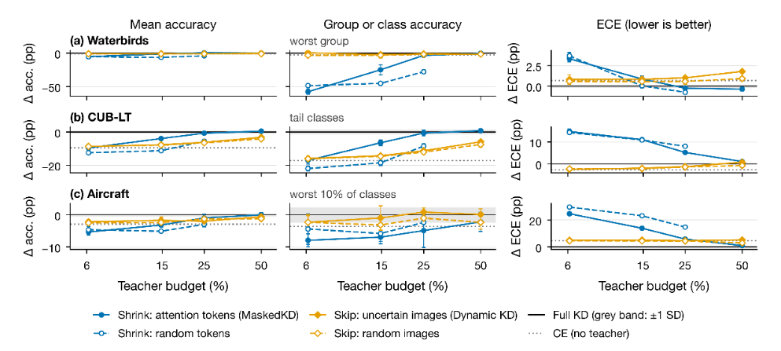

**핵심 내용**

- 토큰 유지율 변화로 인한 선택 방식 순위 변동
- ⇒ 한 예산에서 관측한 우위를 모든 예산으로 일반화하기 어렵다

**대본**

예산 15% 이하에서 Shrink는 최저 그룹 정확도가 떨어지고 ECE가 늘었습니다. 토큰 유지율에 따라 어텐션과 무작위 선택의 우위도 바뀌어, 한 예산의 결과를 일반화하기 어렵습니다.

**용어**

- ECE(기대 보정 오차): 모델이 말한 확신도와 실제 정답률의 차이. 예: 90% 확신한 예측들이 실제로 70%만 맞으면 보정이 나쁨. 낮을수록 좋다.
- 어텐션 선택 / 무작위 선택: 교사가 중요하다고 본 토큰만 남김 / 무작위로 남김.
- %p(퍼센트포인트): 퍼센트 값끼리의 차이.

---

## 12. Experiment – 캐시 대조

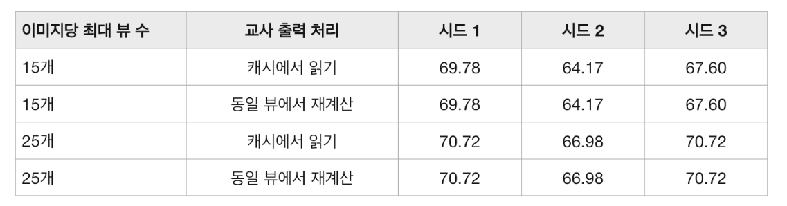

**핵심 내용**

- 캐시 대조: 같은 뷰에서 캐시 읽기와 재계산의 최저 그룹 정확도가 시드별로 동일

**대본**

같은 뷰에서 캐시를 읽든 다시 계산하든 세 시드의 최저 그룹 정확도가 똑같았습니다. Reuse의 하락은 캐시가 아니라 제한된 뷰 수 때문이므로, 저장한 뷰 수를 함께 보고해야 합니다.

**용어**

- 증강 뷰: 한 이미지에 자르기·뒤집기 등 변형을 적용해 만든 학습용 버전.
- 대조 실험: 한 요인만 바꿔 원인을 가려내는 실험(여기서는 캐시 읽기 vs 재계산).

---

## 13. Experiment – 이미지 선택

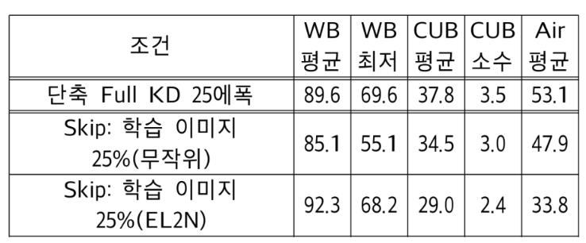

**핵심 내용**

- EL2N: Waterbirds 평균 정확도 상승
- CUB-LT, Aircraft: 무작위 선택보다 평균 정확도가 낮음

**대본**

EL2N 선택은 Waterbirds 평균을 올렸지만, CUB-LT와 Aircraft에서는 무작위보다 낮았습니다. 데이터 Skip은 데이터셋에 따라 결과가 크게 달라집니다.

**용어**

- EL2N: 학습 초기 모델의 예측 오차 크기로 이미지의 '어려움'을 매기는 점수. 어려운 이미지를 우선 선택.

---

## 14. Experiment – 데이터 규모

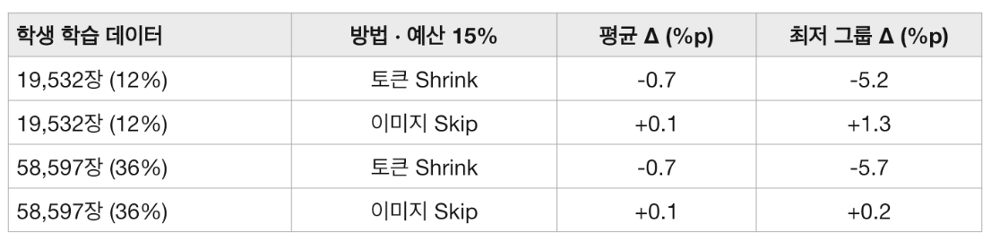

**핵심 내용**

- 학습 이미지를 늘려도 그룹 손실이 남는가?
- 두 규모 모두 Shrink의 최저 그룹 하락이 평균 하락보다 큼

**대본**

CelebA 학습 이미지를 세 배로 늘려도 Shrink는 평균 0.7%p 하락에 최저 그룹 5%p대 하락이 남았습니다. 이미지 Skip은 두 규모 모두 차이가 작았습니다.

**용어**

- CelebA: 얼굴 속성 데이터셋. 여기서는 그룹(속성×성별)별 최저 그룹 정확도를 평가.

---

## 15. Result – 질문에 대한 답

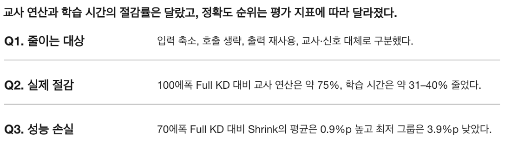

**핵심 내용**

교사 연산과 학습 시간의 절감률은 달랐고, 정확도 순위는 평가 지표에 따라 달라졌다.
- Q1 줄이는 대상: 입력 축소, 호출 생략, 출력 재사용, 교사·신호 대체
- Q2 실제 절감: 교사 연산 약 75%, 학습 시간 약 31–40%
- Q3 성능 손실: 70에폭 Full KD 대비 Shrink 평균 +0.9%p, 최저 그룹 −3.9%p

**대본**

교사 연산은 약 75% 줄었지만 학습 시간은 31–40%만 줄었습니다. 70에폭 Full KD 대비 Shrink는 평균이 0.9%p 높고 최저 그룹은 3.9%p 낮았습니다. 절감률도 순위도 무엇을 재느냐에 따라 달라집니다.

---

## 16. Result – 보고 권고

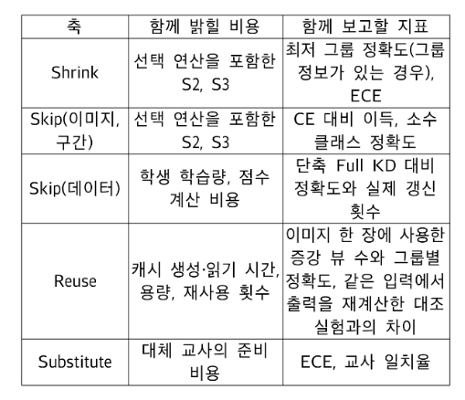

**핵심 내용**

1. 준비 비용을 몇 번의 학습에 나누어 산정했는지 명시
2. 비슷한 시간 동안 학습한 기준선과 비교
3. 그룹 정보가 있는 경우 최저 그룹 정확도 보고
4. 클래스 간 학습 표본 수 차이가 큰 경우 소수 클래스 정확도를 평균 정확도/표준편차로 비교

**대본**

준비 비용을 몇 번의 학습에 나눴는지 밝히고, 비슷한 시간의 기준선과 비교해야 합니다. 그룹 정보가 있으면 최저 그룹 정확도, 불균형이 크면 소수 클래스 정확도를 평균·표준편차와 함께 보고할 것을 권고합니다.

**용어**

- 기준선(baseline): 새 기법과 비교하는 기본 방법.
- 표준편차: 시드 간 결과가 얼마나 흔들리는지.

---

## 17. Experiment+ – CNN 재검증

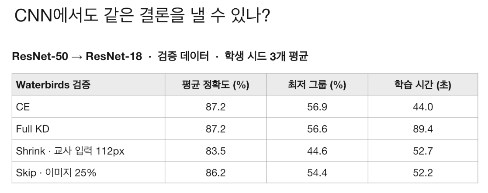

**핵심 내용**

- CNN을 이용한 재검증: ResNet-50 → ResNet-18, Waterbirds 검증 데이터, 학생 시드 3개 평균

**대본**

ResNet-50 → ResNet-18에서도 교사 입력을 112px로 줄인 Shrink는 최저 그룹이 56.6%에서 44.6%로 크게 떨어졌습니다. 이미지 Skip은 하락이 작았습니다.

**용어**

- CNN: 합성곱 신경망(ResNet 등). ViT와 다른 구조라 결론이 일반화되는지 확인.
- 112px: 교사 입력 해상도를 224px에서 절반으로 줄인 Shrink.

---

## 18. Experiment+ – 시드별 일관성

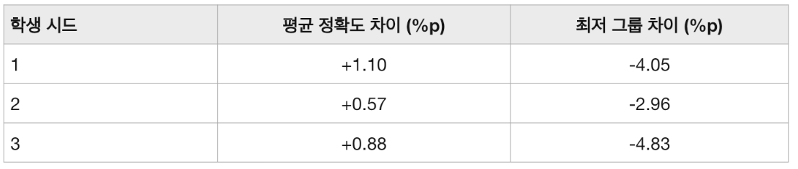

**핵심 내용**

- Waterbirds로 인한 순위 변동의 일관성 (시드별 차이)

**대본**

Shrink와 70에폭 Full KD의 차이는 세 시드 모두 평균 +0.57~+1.10%p, 최저 그룹 −2.96~−4.83%p였습니다. 순위 역전은 시드 변동이 아닙니다.

---

## 19. Experiment+ – 평균 밖의 지표

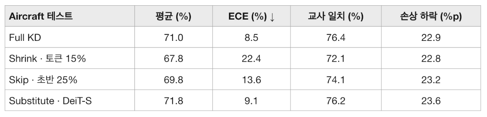

**핵심 내용**

- 평균 정확도 밖의 지표 비교: ECE, 원래 DeiT-B 교사와 top-1 예측 일치율, 입력 손상 시 평균 정확도 하락
- ≫ 추가 평가 진행

**대본**

Aircraft에서 토큰 15% Shrink는 평균이 3.2%p 떨어졌지만 ECE는 8.5%에서 22.4%로 크게 늘었습니다. Substitute는 Full KD와 거의 같았습니다. 평균 밖 지표 평가를 계속 진행하고 있습니다.

**용어**

- ECE: 확신도와 실제 정답률의 차이(낮을수록 좋음).
- 교사 일치율: 학생과 교사의 top-1 예측이 같은 비율.
- 입력 손상 하락: 노이즈·블러 등을 넣었을 때 정확도가 얼마나 떨어지는지(강건성).

---

## 20. 마무리

**핵심 내용**

Thank you for paying attention

**대본**

이상으로 발표를 마치겠습니다. 감사합니다.

---
