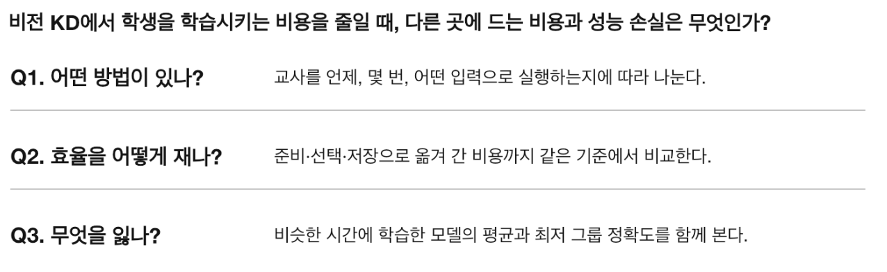

# 2. 연구 질문

슬라이드 제목: **Question**

## 대본

저희가 던진 큰 질문은 이것입니다. 비전 지식 증류에서 학생을 학습시키는 비용을 줄일 때, 다른 곳에 드는 비용과 성능 손실은 무엇인가?

이 질문을 세 가지로 나눴습니다.

첫째, 어떤 방법이 있는가. 교사를 언제, 몇 번, 어떤 입력으로 실행하는지에 따라 방법을 나눴습니다.

둘째, 효율을 어떻게 재는가. 줄어든 비용만 보지 않고, 준비·선택·저장 단계로 옮겨 간 비용까지 같은 기준에서 비교했습니다.

셋째, 무엇을 잃는가. 비슷한 시간 동안 학습한 모델끼리 평균 정확도와 최저 그룹 정확도를 함께 봤습니다.
