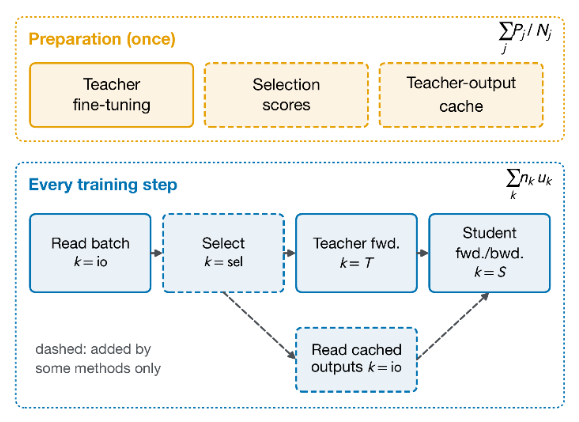

# 3. 조사 방법

슬라이드 제목: **Searching**

## 대본

먼저 A, 비용 분해입니다. 증류 학습의 비용은 학습 전에 한 번 드는 준비 비용과, 매 스텝 반복되는 반복 비용으로 나눌 수 있습니다. 준비 비용에는 교사의 미세 조정, 데이터 선택 점수 계산, 교사 출력 캐시 생성이 들어갑니다. 반복 비용은 배치 읽기, 교사 순전파, 학생 순전파·역전파이고, 기법에 따라 선택 연산이나 캐시 읽기가 더해집니다.

어느 비용 항을 줄이느냐에 따라 기법을 Shrink, Skip, Reuse, Substitute의 네 축으로 나눴습니다.

다음 B, 문헌 비용 검증입니다. 최종 40편의 문헌을 조사해 각 논문이 어떤 비용을 어떤 범위에서 보고했는지 확인했습니다. 그리고 문헌만으로는 비교가 부족한 부분은 저희가 직접 실험으로 검증했습니다.
