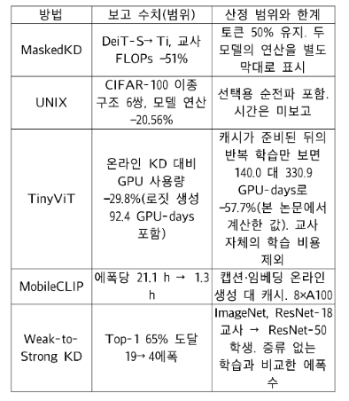

# 4. 보고값 사례: TinyViT

슬라이드 제목: **Result**

## 대본

왜 측정 범위를 따져야 하는지 보여 주는 사례입니다. 표는 다섯 논문이 보고한 비용 절감 수치와 그 산정 범위입니다.

TinyViT를 보면, 원 논문은 온라인 KD 대비 GPU 사용량이 29.8% 줄었다고 보고합니다. 이 값에는 교사 로짓을 미리 생성하는 데 든 92.4 GPU-days가 포함되어 있습니다.

반면 캐시가 준비된 뒤 학생의 반복 학습만 비교하면 140.0 대 330.9 GPU-days로, 57.7%가 줄어든 것으로 계산됩니다. 이 값은 저희가 계산한 값입니다.

같은 방법인데 어디까지 세느냐에 따라 절감률이 두 배 가까이 달라집니다. 그래서 비용을 비교하려면 먼저 측정 범위를 정의해야 합니다.
