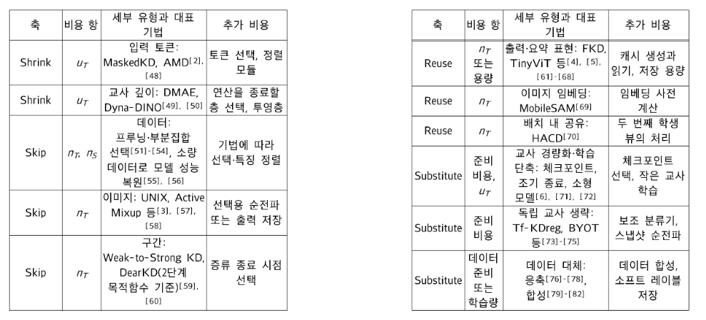

# 5. 네 축 분류

슬라이드 제목: **Researching**

## 대본

네 가지 기법에서 바뀌는 비용과 학습 신호를 정리한 표입니다.

Shrink는 교사 입력 토큰이나 교사 깊이를 줄여서 교사 순전파 1회의 비용을 줄입니다. MaskedKD, AMD, DMAE, Dyna-DINO가 여기에 속하고, 토큰 선택이나 정렬 모듈 같은 추가 비용이 생깁니다.

Skip은 교사 호출 횟수를 줄입니다. 데이터 자체를 줄이는 데이터 Skip, 일부 이미지에만 교사를 쓰는 이미지 Skip, 학습 일부 구간에만 증류하는 구간 Skip으로 나뉩니다.

Reuse는 교사 출력을 저장해 두고 다시 씁니다. FKD, TinyViT처럼 출력을 캐시하는 경우, MobileSAM처럼 임베딩을 미리 계산하는 경우, HACD처럼 배치 안에서 공유하는 경우가 있습니다. 대신 캐시 생성·읽기 시간과 저장 용량이 듭니다.

Substitute는 교사 자체나 데이터를 더 싼 것으로 바꿉니다. 작은 교사, 체크포인트 교사, 교사 없는 자기 증류, 그리고 데이터셋 응축이나 합성 데이터가 여기에 속합니다.
