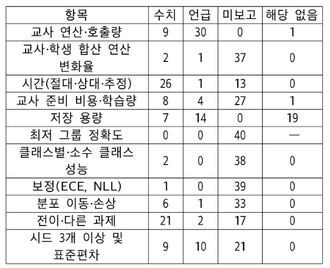

# 6. 문헌 조사 결과

슬라이드 제목: **Researching**

## 대본

40편이 각 항목을 어떻게 보고했는지 센 표입니다. 수치로 보고했는지, 서술로만 언급했는지, 보고하지 않았는지로 나눴습니다.

교사 연산량은 9편이 수치로 보고했고, 시간은 26편이 보고했습니다. 하지만 교사와 학생을 합친 연산 변화율을 직접 보고한 논문은 2편뿐입니다. 교사 준비 비용도 8편만 수치로 보고했습니다.

성능 쪽은 더 드뭅니다. 최저 그룹 정확도를 보고한 논문은 한 편도 없고, 클래스별 성능은 2편, 보정 오차는 1편입니다. 시드 3개 이상과 표준편차를 보고한 논문도 9편입니다.

즉 문헌만으로는 기법 사이의 비용과 그룹별 성능을 같은 조건에서 비교할 수 없어서, 저희가 직접 실험을 했습니다.
