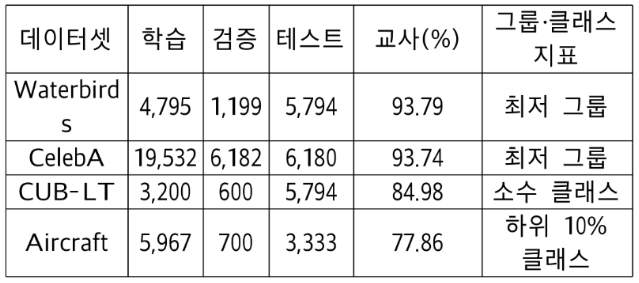

# 7. 실험 질문과 데이터

슬라이드 제목: **Experiment**

## 대본

실험에서는 세 가지 질문을 봤습니다.

Q1, 얼마나 비용을 줄이는가. 같은 범위에서 100에폭 Full KD와 비교했습니다.

Q2, 교사 연산을 줄인 만큼 실제 시간도 줄어드는가. 60에폭, 70에폭으로 줄인 단축 Full KD와 비교했습니다.

Q3, 비슷한 시간에서 평균 정확도와 최저 그룹 정확도의 순위가 같은가. 토큰 예산, 뷰 수, 데이터 선택, 데이터 규모를 바꾼 대조 실험으로 확인했습니다.

데이터셋은 네 개입니다. Waterbirds와 CelebA는 최저 그룹 정확도를, CUB-LT는 소수 클래스 정확도를, Aircraft는 하위 10% 클래스 정확도를 봤습니다. 교사 정확도는 표 오른쪽에 있습니다.
