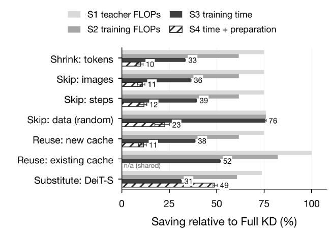

# 8. Q1·Q2: 연산 대비 시간 절감

슬라이드 제목: **Experiment**

## 대본

예산 25%에서 세 데이터셋 평균으로, 교사 연산량과 실제 시간이 얼마나 줄었는지 보여 주는 그림입니다. 막대는 위에서부터 S1 교사 연산, S2 학습 전체 연산, S3 학습 시간, S4 준비 시간까지 포함한 시간입니다.

교사 연산은 대부분 약 75% 줄었지만, 실제 학습 시간은 Shrink 33%, 이미지 Skip 36%, 구간 Skip 39%, Reuse 38% 줄어드는 데 그쳤습니다. 학생 학습과 데이터 읽기 시간은 그대로 남기 때문입니다.

준비 시간까지 포함한 S4로 보면 절감률은 10% 안팎으로 더 떨어집니다. 반대로 Substitute는 작은 교사를 쓰기 때문에 S4에서 49%로 가장 크게 줄었습니다. 이렇게 어느 범위로 재느냐에 따라 기법 간 순위가 달라집니다.
