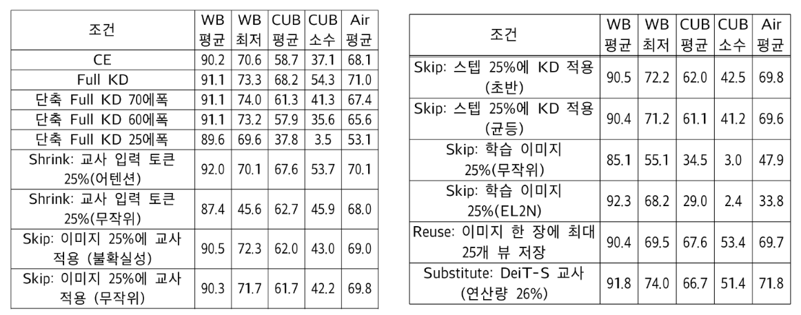

# 9. 네 축 대표 조건 결과

슬라이드 제목: **Experiment**

## 대본

네 축의 대표 조건을 비교한 결과표입니다. WB는 Waterbirds, CUB는 CUB-LT, Air는 Aircraft입니다.

기준선은 교사 없이 학습한 CE, 100에폭 Full KD, 그리고 학습 기간을 줄인 단축 Full KD입니다.

CUB-LT와 Aircraft에서는 Shrink 어텐션, Reuse, Substitute가 비슷한 시간의 단축 Full KD보다 평균 정확도가 높았습니다. 예를 들어 CUB-LT 평균은 70에폭 Full KD가 61.3%인데, Shrink 어텐션은 67.6%, Reuse도 67.6%입니다.

반면 학습 이미지 자체를 25%로 줄인 데이터 Skip은 정확도가 크게 떨어졌습니다. Substitute는 DeiT-S 교사로 연산량 26%만 쓰고도 Full KD와 비슷하거나 높은 성능을 보였습니다.
