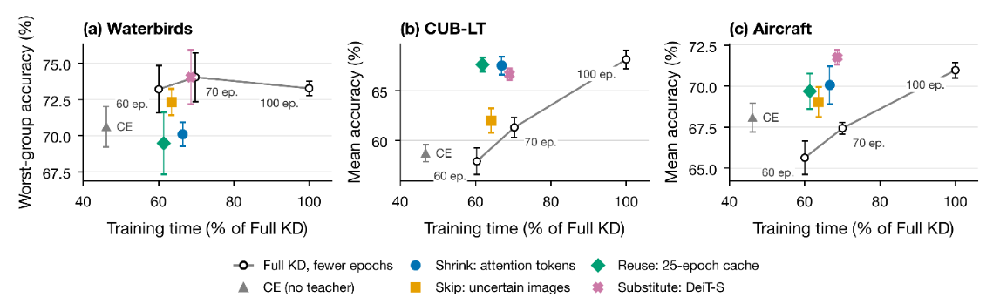

# 10. Waterbirds 순위 역전

슬라이드 제목: **Experiment**

## 대본

여기서부터 Q3입니다. 가로축은 학습 시간, 세로축은 Waterbirds 최저 그룹 정확도와 CUB-LT, Aircraft 평균 정확도입니다. 회색 선은 단축 Full KD입니다.

Waterbirds에서 어텐션 Shrink는 463초로, 487초인 70에폭 Full KD보다 빠릅니다. 평균 정확도도 92.0% 대 91.1%로 더 높습니다. 그런데 최저 그룹 정확도는 70.1% 대 74.0%로 더 낮습니다.

세 시드 모두에서 같은 방향이었습니다. 평균 정확도로 고르면 Shrink가, 최저 그룹 정확도로 고르면 70에폭 Full KD가 더 낫습니다. 어떤 지표를 보느냐에 따라 판단이 바뀌는 것입니다.
