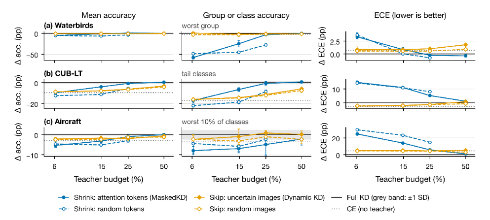

# 11. 예산별 선택 방식 비교

슬라이드 제목: **Experiment**

## 대본

교사 예산을 6, 15, 25, 50%로 바꿔 가며, Full KD 대비 테스트 지표가 얼마나 변했는지 본 그림입니다. 파란색은 Shrink, 주황색은 이미지 Skip이고, 실선은 학습된 선택 방식, 점선은 무작위 선택입니다.

Shrink는 예산이 15% 이하로 내려가면 Waterbirds 최저 그룹 정확도가 크게 떨어지고, CUB-LT와 Aircraft에서는 ECE가 크게 늘어납니다. 평균 정확도만 보면 이 손실이 잘 보이지 않습니다.

또 토큰 유지율에 따라 어텐션 선택과 무작위 선택 중 어느 쪽이 나은지가 바뀝니다. 그래서 한 예산에서 관측한 우위를 모든 예산으로 일반화하기 어렵습니다.
