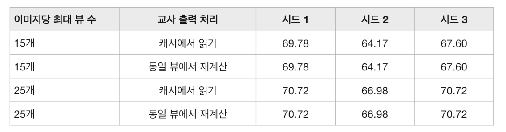

# 12. Reuse 캐시 대조 실험

슬라이드 제목: **Experiment**

## 대본

Reuse에서 정확도가 떨어진 원인이 캐시 자체인지 확인한 대조 실험입니다.

이미지당 최대 뷰 수를 15개와 25개로 두고, 같은 증강 뷰에 대해 교사 출력을 캐시에서 읽은 경우와 매번 다시 계산한 경우를 비교했습니다.

결과는 세 시드 모두에서 최저 그룹 정확도가 소수점까지 똑같았습니다. 즉 성능 차이는 캐시를 썼기 때문이 아니라, 한 이미지에 쓸 수 있는 뷰 수가 제한되었기 때문입니다. 15개에서 25개로 늘리면 정확도가 올라갑니다.

그래서 Reuse 논문은 이미지당 저장한 뷰 수를 함께 보고해야 한다고 생각합니다.
