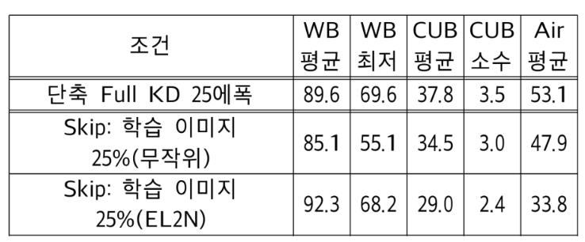

# 13. 데이터 Skip 선택 방식

슬라이드 제목: **Experiment**

## 대본

예산 25%에서 학습 이미지를 고르는 방식을 비교했습니다. 무작위 선택과 EL2N 점수 기반 선택, 그리고 같은 스텝 수의 25에폭 Full KD입니다.

Waterbirds에서는 EL2N이 평균 정확도 92.3%로 무작위 85.1%보다 높았습니다.

하지만 CUB-LT와 Aircraft에서는 EL2N이 각각 29.0%, 33.8%로 무작위보다 오히려 낮았습니다. 클래스 수가 많은 데이터에서는 어려운 이미지만 고르면 일부 클래스가 빠지기 때문으로 보입니다.

또 두 방식 모두 단축 Full KD 25에폭보다 대체로 낮았습니다. 데이터 Skip은 데이터셋에 따라 결과가 크게 달라집니다.
