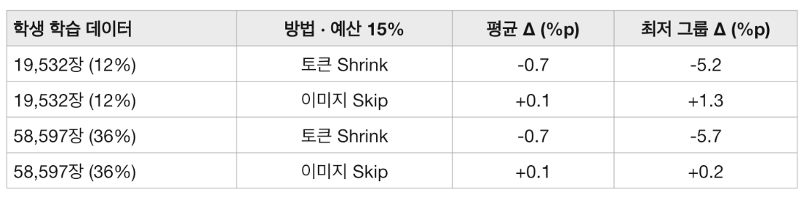

# 14. CelebA 데이터 규모 대조

슬라이드 제목: **Experiment**

## 대본

학습 이미지를 늘리면 그룹 손실이 사라지는지 CelebA에서 확인했습니다. 학습 데이터를 19,532장과 58,597장 두 규모로 두고, 예산 15%에서 토큰 Shrink와 이미지 Skip을 비교했습니다.

토큰 Shrink는 두 규모 모두 평균 정확도가 0.7%p만 떨어졌지만, 최저 그룹 정확도는 5.2%p, 5.7%p 떨어졌습니다. 최저 그룹 하락이 평균 하락보다 훨씬 큽니다.

이미지 Skip은 두 규모 모두 큰 차이가 없었습니다. 데이터를 세 배로 늘려도 Shrink의 그룹 손실은 남았습니다.
