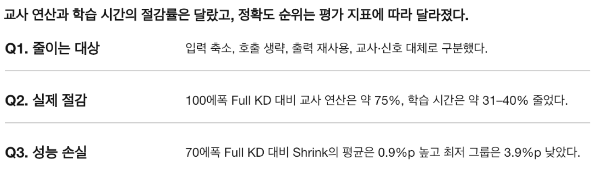

# 15. 처음 질문에 대한 답

슬라이드 제목: **Result**

## 대본

처음 질문에 답하면, 교사 연산과 학습 시간의 절감률은 달랐고, 정확도 순위는 평가 지표에 따라 달라졌습니다.

Q1, 줄이는 대상. 입력 축소, 호출 생략, 출력 재사용, 교사·신호 대체로 구분했습니다.

Q2, 실제 절감. 100에폭 Full KD 대비 교사 연산은 약 75% 줄었지만, 학습 시간은 약 31에서 40%만 줄었습니다.

Q3, 성능 손실. 70에폭 Full KD 대비 Shrink는 평균 정확도가 0.9%p 높았지만 최저 그룹 정확도는 3.9%p 낮았습니다.
