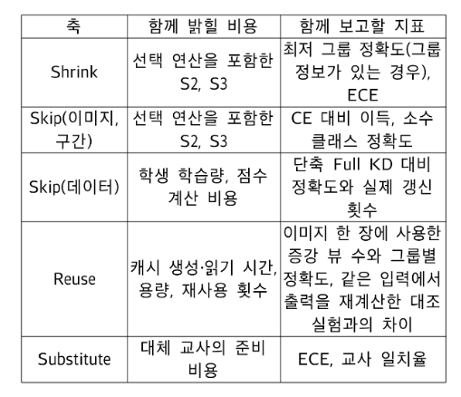

# 16. 보고 권고

슬라이드 제목: **Result**

## 대본

이 결과를 바탕으로 효율적 증류 연구가 함께 보고해야 할 것을 네 가지로 정리했습니다.

첫째, 준비 비용을 몇 번의 학습에 나누어 산정했는지 밝힐 것.

둘째, 비슷한 시간 동안 학습한 기준선과 비교할 것.

셋째, 그룹 정보가 있는 경우 최저 그룹 정확도를 보고할 것.

넷째, 클래스 간 학습 표본 수 차이가 큰 경우 소수 클래스 정확도를 평균 정확도, 표준편차와 함께 비교할 것.

표는 축별로 함께 밝힐 비용과 지표입니다. 예를 들어 Shrink와 Skip은 선택 연산을 포함한 비용을, Reuse는 캐시 생성·읽기 시간과 저장한 뷰 수를, Substitute는 대체 교사의 준비 비용과 교사 일치율을 함께 보고하는 것을 권고합니다.
