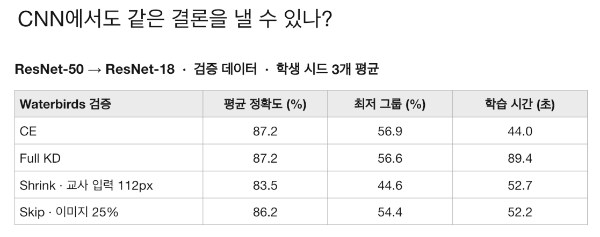

# 17. 추가 실험: CNN 재검증

슬라이드 제목: **Experiment+**

## 대본

여기부터는 추가 실험입니다. 같은 결론이 CNN에서도 나오는지 확인했습니다. ResNet-50 교사, ResNet-18 학생으로, Waterbirds 검증 데이터에서 학생 시드 3개를 평균했습니다.

Full KD는 89.4초가 걸렸고, 교사 입력을 112픽셀로 줄인 Shrink는 52.7초, 이미지 25%만 쓰는 Skip은 52.2초였습니다.

그런데 Shrink는 평균 정확도가 87.2%에서 83.5%로, 최저 그룹 정확도는 56.6%에서 44.6%로 떨어졌습니다. 최저 그룹 쪽 하락이 훨씬 큽니다. Skip은 하락이 작았습니다.

CNN에서도 Shrink가 그룹 성능을 더 크게 잃는 경향은 같았습니다.
