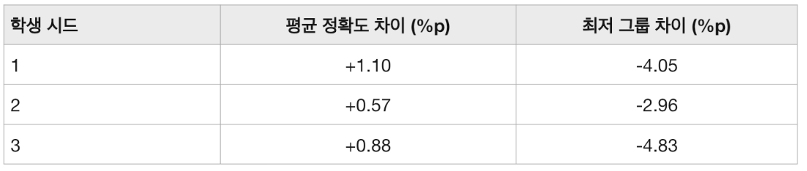

# 18. 추가 실험: 시드별 일관성

슬라이드 제목: **Experiment+**

## 대본

Waterbirds 순위 역전이 우연인지 시드별로 확인했습니다. 어텐션 Shrink에서 70에폭 Full KD를 뺀 차이입니다.

세 시드 모두 평균 정확도는 0.57에서 1.10%p 높았고, 최저 그룹 정확도는 2.96에서 4.83%p 낮았습니다.

방향이 세 시드에서 모두 같기 때문에, 평균과 최저 그룹의 순위가 뒤바뀌는 현상은 시드 변동만으로 설명되지 않습니다.
