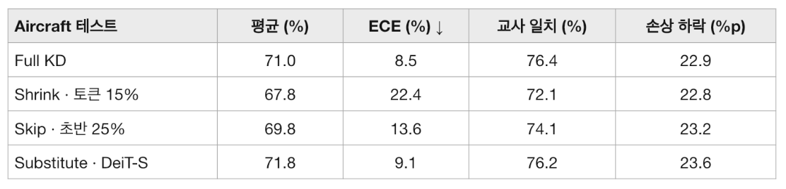

# 19. 추가 실험: 평균 밖의 지표

슬라이드 제목: **Experiment+**

## 대본

마지막으로 평균 정확도 밖의 지표를 Aircraft 테스트 데이터에서 비교했습니다. 기대 보정 오차 ECE, 원래 DeiT-B 교사와의 top-1 예측 일치율, 입력 손상 시 평균 정확도 하락입니다.

토큰 15%의 Shrink는 평균이 67.8%로 3.2%p 떨어졌지만, ECE는 8.5%에서 22.4%로 크게 늘었습니다. 예측 확신도가 실제 정확도와 크게 어긋난다는 뜻입니다. 교사 일치율도 72.1%로 가장 낮았습니다.

반면 Substitute는 평균 71.8%, ECE 9.1%, 교사 일치율 76.2%로 Full KD와 거의 같았습니다. 입력 손상 시 하락 폭은 네 조건이 비슷했습니다.

이처럼 평균 정확도만으로는 보이지 않는 손실이 있어서, 추가 평가를 계속 진행하고 있습니다.
